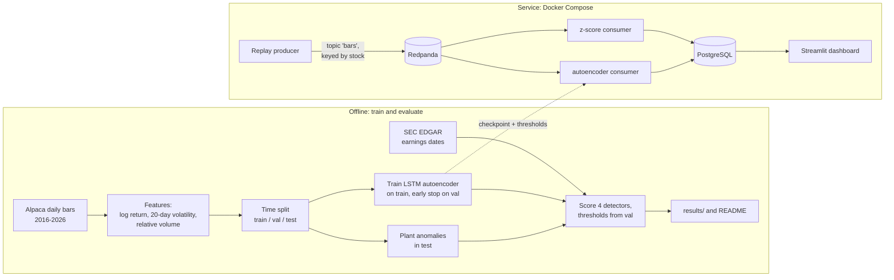

# anomaly-pipeline

A PyTorch LSTM autoencoder that learns what normal daily price and volume
movement looks like for 30 large US stocks, measured honestly against a simple
z-score rule, then run as a streaming service next to that rule:
Redpanda → two detector consumers → PostgreSQL → Streamlit.

This detects unusual movement. It does not predict prices or give trading
signals.

> **All headline numbers come from anomalies planted into real 2025-2026 data,
> not from labelled real events.** Real anomalies have no labels, so the test
> plants four kinds of known anomaly at known sizes and counts how many each
> detector finds. Every number below is generated from `results/` by
> `scripts/readme_results.py`; a test fails if the README and the results disagree.

## Results in short

- **When alarms must be rare, the autoencoder finds the most planted anomalies.**
  With every detector given the same alarm budget on the test period, it leads
  overall at 0.25 and 0.5 alarms per stock per month.
- **The simple z-score rule still wins on price-only anomalies.** At an equal
  budget of 0.5 alarms per stock per month, it beats the autoencoder on spikes,
  level shifts and volatility bursts.
  The autoencoder's overall lead comes from volume surges, which a price-only rule
  cannot see.
- **The autoencoder's threshold drifts.** Set on 2023-2024 to flag as often as
  the z-score rule, it flags about twice as often on 2025-2026, while the z-score
  rule stays on target. Intel draws more of its alarms than any other stock.
- **Lower training loss did not mean better detection.** Retraining for longer
  lowered validation loss but left recall about the same
  ([DECISIONS.md](DECISIONS.md) #25).

## Architecture



Both consumers rebuild features with the same `build_features` code used offline
and keep the last 50 bars per stock. A unit test checks the streamed scores equal
the offline scores for every day, and an integration test runs the whole stack
in Docker Compose and checks every score and flag written to Postgres.

## Data

Daily bars from the Alpaca Market Data API (free plan, full-market SIP feed,
split- and dividend-adjusted), 2016-01-04 to 2026-11-13, for 30 large US stocks.
The split is by time and never shuffled; scaling statistics come from the
training period only.

<!-- BEGIN GENERATED: data -->
30 stocks, daily bars. Rows are stock-days with full features; windows are 30-day sequences that lie entirely inside one split.

| Split | Days | Rows | Windows |
|---|---|---|---|
| train | 2016-02-02 to 2022-12-30 | 52,260 | 51,390 |
| val | 2023-01-03 to 2024-12-31 | 15,060 | 14,190 |
| test | 2025-01-02 to 2026-11-13 | 14,070 | 13,200 |
<!-- END GENERATED: data -->

## The detectors

1. **Z-score**: today's return against the mean and standard deviation of the
   previous 20 returns. The original pipeline's rule. Price only.
2. **Robust z-score**: the same with median and MAD, on all three features.
3. **Isolation forest** (scikit-learn), on the three features of each day.
4. **LSTM autoencoder** (10,475 parameters): reads a 30-day window, squeezes it
   through an 8-number bottleneck, and rebuilds it. A day's score is how badly it
   rebuilds that day as the newest in its window.

<!-- BEGIN GENERATED: training -->
Trained for 134 epochs on CPU; early stopping kept epoch 129 (validation loss 0.3334, training loss 0.4429).
<!-- END GENERATED: training -->

## How detectors are scored

- **Four planted kinds, several sizes each:** a one-day spike and a level shift
  (2 to 8 times the stock's recent daily volatility, σ), a volatility burst
  (returns ×2 to ×5 for 5 to 10 days), and a volume surge with no price move
  (volume ×3 to ×10 for 1 to 3 days). Planted into raw prices and volume, so the
  features react the way they would to a real event.
- **Thresholds are set on the untouched validation period** to a target alarm
  rate. The test period never chooses a threshold in the headline tables.
- **An alarm** is a run of consecutive flagged days in one stock. **An event is
  caught** if an alarm overlaps it or the 2 trading days after it.
- **Precision** counts alarms that catch a planted event. Real unusual days in
  the test period count as false alarms, so precision is also shown with alarms
  within a day of an earnings release (SEC EDGAR) set aside.

## Results

<!-- BEGIN GENERATED: headline -->
**1,800 planted events** (10 passes over the test period). Cells are caught/planted.

**Threshold set on validation for 1 per stock per quarter:**

| Kind | z-score | robust | isolation forest | autoencoder |
|---|---|---|---|---|
| spike | 330/450 (73%) | 220/450 (49%) | 297/450 (66%) | 354/450 (79%) |
| level_shift | 291/450 (65%) | 174/450 (39%) | 252/450 (56%) | 305/450 (68%) |
| vol_burst | 330/450 (73%) | 256/450 (57%) | 331/450 (74%) | 384/450 (85%) |
| volume_surge | 30/450 (7%) | 175/450 (39%) | 356/450 (79%) | 345/450 (77%) |
| **All kinds** | 981/1800 (55%) | 825/1800 (46%) | 1236/1800 (69%) | 1388/1800 (77%) |
| Precision | 1100/2897 (38%) | 863/3131 (28%) | 1482/5376 (28%) | 1782/6395 (28%) |
| Precision, earnings days set aside | 1100/2267 (49%) | 863/2648 (33%) | 1482/4430 (33%) | 1782/5737 (31%) |
| False alarms per stock per month on test | 0.27 | 0.34 | 0.58 | 0.69 |

**Threshold set on validation for 1 per stock per month:**

| Kind | z-score | robust | isolation forest | autoencoder |
|---|---|---|---|---|
| spike | 411/450 (91%) | 359/450 (80%) | 392/450 (87%) | 402/450 (89%) |
| level_shift | 368/450 (82%) | 313/450 (70%) | 360/450 (80%) | 374/450 (83%) |
| vol_burst | 413/450 (92%) | 374/450 (83%) | 425/450 (94%) | 426/450 (95%) |
| volume_surge | 83/450 (18%) | 380/450 (84%) | 431/450 (96%) | 416/450 (92%) |
| **All kinds** | 1275/1800 (71%) | 1426/1800 (79%) | 1608/1800 (89%) | 1618/1800 (90%) |
| Precision | 1569/7260 (22%) | 1546/7693 (20%) | 1958/10452 (19%) | 2132/12891 (17%) |
| Precision, earnings days set aside | 1569/6249 (25%) | 1546/6560 (24%) | 1958/9024 (22%) | 2132/11671 (18%) |
| False alarms per stock per month on test | 0.85 | 0.92 | 1.27 | 1.61 |

The original rule as it stands, |z| > 3, catches 1074/1800 (60%) with precision 1224/3596 (34%).
<!-- END GENERATED: headline -->

**Read these with care.** Each detector's threshold was set on validation, but
the detectors overshoot their alarm budgets on test by different amounts (last
row), so part of a recall lead can be bought with extra alarms. The fair
comparison is below.

## Error analysis

Full report: [results/error_analysis.md](results/error_analysis.md).

### Equal alarm budget

Thresholds set so every detector raises the same number of alarms on the
untouched test period. This uses test data, so it is analysis only.

<!-- BEGIN GENERATED: equal-budget -->
| Alarms per stock per month | z-score | robust | isolation forest | autoencoder |
|---|---|---|---|---|
| 0.25 | 881/1800 (49%) | 638/1800 (35%) | 517/1800 (29%) | 1086/1800 (60%) |
| 0.5 | 1108/1800 (62%) | 1078/1800 (60%) | 1137/1800 (63%) | 1306/1800 (73%) |
| 1 | 1268/1800 (70%) | 1408/1800 (78%) | 1486/1800 (83%) | 1496/1800 (83%) |
| 2 | 1445/1800 (80%) | 1703/1800 (95%) | 1706/1800 (95%) | 1663/1800 (92%) |

By kind, at 0.5 alarms per stock per month:

| Kind | z-score | robust | isolation forest | autoencoder |
|---|---|---|---|---|
| spike | 371/450 (82%) | 277/450 (62%) | 277/450 (62%) | 343/450 (76%) |
| level_shift | 324/450 (72%) | 225/450 (50%) | 232/450 (52%) | 288/450 (64%) |
| vol_burst | 371/450 (82%) | 305/450 (68%) | 313/450 (70%) | 362/450 (80%) |
| volume_surge | 42/450 (9%) | 271/450 (60%) | 315/450 (70%) | 313/450 (70%) |
| **All kinds** | 1108/1800 (62%) | 1078/1800 (60%) | 1137/1800 (63%) | 1306/1800 (73%) |
<!-- END GENERATED: equal-budget -->

### Chance floor

Alarms raised on the untouched test period, scored against the same event
windows. Nothing was planted there, so those catches are coincidence. Long events
(volatility bursts) are easy to "catch" by luck, and the z-score's recall on
volume surges is exactly its chance level.

<!-- BEGIN GENERATED: chance -->
| Kind (chance / real) | z-score | robust | isolation forest | autoencoder |
|---|---|---|---|---|
| spike | 16% / 91% | 24% / 80% | 26% / 87% | 24% / 89% |
| level_shift | 12% / 82% | 22% / 70% | 21% / 80% | 18% / 83% |
| vol_burst | 39% / 92% | 44% / 83% | 48% / 94% | 48% / 95% |
| volume_surge | 18% / 18% | 30% / 84% | 28% / 96% | 30% / 92% |
<!-- END GENERATED: chance -->

### Alarms on real, untouched 2025-2026 data

At the quarterly validation threshold. Without labels these mix real events and
false alarms. The learned detectors concentrate on Intel: per-stock scaling is
fitted on 2016-2022, and Intel's recent moves are far larger than its old ones.

<!-- BEGIN GENERATED: real-data -->
| Detector | Alarms | Per stock per month | On earnings days | Most-flagged stock |
|---|---|---|---|---|
| z-score | 226 | 0.34 | 34% | JPM (11) |
| robust | 209 | 0.31 | 24% | CSCO (12) |
| isolation forest | 379 | 0.57 | 26% | INTC (60) |
| autoencoder | 443 | 0.66 | 12% | INTC (83) |
<!-- END GENERATED: real-data -->

The report also lists, by month, when alarms cluster (April 2025 is by far the
busiest), what each detector misses by kind and size, and the 20 real days the
autoencoder flags most strongly, for looking up by hand.

## The service

Thresholds: the z-score consumer keeps the original rule, |z| > 3. The
autoencoder's threshold is set on validation to flag exactly as often as that rule.

<!-- BEGIN GENERATED: service -->
| Detector | Threshold | Validation alarms per stock per month | Flagged days, 2025-2026 | Per stock per month |
|---|---|---|---|---|
| z-score | 3 | 0.47 | 306 | 0.46 |
| autoencoder | 1.807 | 0.47 | 705 | 1.05 |

Flagged by both: 168 days; z-score only: 138; autoencoder only: 537.
<!-- END GENERATED: service -->

These counts are computed offline by `scripts/thresholds.py`. A replay of the
real data through the running service wrote the same counts to Postgres.

Reliability: messages are keyed by stock, so each stock's bars arrive in order.
A consumer commits its database write before its Kafka offsets, and every write
is an upsert on (stock, day, detector), so reprocessing a bar changes nothing.

## Setup

Needs [uv](https://docs.astral.sh/uv/), Python 3.13, and Docker for the service.

```bash
git clone https://github.com/taitohold/anomaly-pipeline.git
cd anomaly-pipeline
make install
cp .env.example .env   # then fill in the three values
```

`.env` needs a free Alpaca paper-trading API key pair, and `SEC_USER_AGENT`: your
name and email, which the SEC asks automated clients to send.

**Reproduce every number in this README** (about 15 minutes, mostly training):

```bash
make reproduce
```

This downloads the bars and earnings dates (skipped if `data/raw/` already has
them), builds features, trains the model, sets thresholds, runs the comparison
and the error analysis, and rewrites the numbers above. The download end date
is pinned, and training runs on CPU with a fixed seed, so a rerun gives the same
results.

**Run the service:**

```bash
make up        # Redpanda, Postgres, both consumers, dashboard at http://localhost:8501
make replay    # replay 2024-10-15 to 2026-11-13 into the pipeline
make down
```

**Tests:** `make test` (unit tests, synthetic data only) and `make integration`
(the whole stack in Docker Compose on synthetic bars). CI runs both on every push.

## Origin and authorship

- **The pipeline design** (REST API → Redpanda → z-score detector → PostgreSQL →
  Streamlit) comes from an earlier team project I worked on, Market Anomaly Pipeline.
  That project's code was not available, so nothing here is copied from it.
- **New in this repo:** the learned detector and its training, the planted-anomaly
  evaluation, the baselines, the error analysis, the earnings check, and the
  rebuilt streaming service with its tests.
- **Who wrote it:** all code in this repo was written by Claude, Anthropic's AI
  coding assistant, working under my direction. I wrote the spec, approved a plan
  before each milestone, made the design choices, and reviewed the results. Each
  decision, with the alternatives and reasons, is in [DECISIONS.md](DECISIONS.md).
- **Data:** market data from Alpaca, used under its personal, non-commercial
  terms. No raw bars are committed and the dashboard is not deployed. Earnings
  dates are from SEC EDGAR, a public US government source.

## Limitations

- **Planted anomalies are not real ones.** Good numbers show the detectors find
  the shapes that were planted, not that they find the events a person would
  care about.
- **Regime drift.** Scaling and thresholds come from 2016-2024. The learned
  detectors flag more often in 2025-2026 than their thresholds intend,
  concentrated in Intel. Rolling scaling or periodic retraining would be the
  next step; neither is done.
- **One time split.** There is no rolling (walk-forward) re-evaluation, so the
  results rest on a single test period of about 23 months.
- **Precision is approximate.** Real events in the test period count as false
  alarms. The earnings check covers only earnings releases, and it found almost
  none for Exxon, which reports results under a different filing item. One long
  planted event can also set off several alarms that all count as true.
- **Survivorship bias.** The 30 stocks are today's large companies, picked with
  hindsight.
- **Daily bars only,** and the service replays saved data; there is no live feed.
- **Consumers rebuild their state by re-reading the topic from the start** on a
  restart. That is fine for a replay but would not scale to a live, unbounded topic.
- **CI uses synthetic data,** because the market data cannot be redistributed. The
  real-data numbers are reproduced locally with `make reproduce`.

## More

- [SPEC.md](SPEC.md): what this set out to do.
- [PLAN.md](PLAN.md): the milestone 0 plan.
- [DECISIONS.md](DECISIONS.md): every major decision, with alternatives and reasons.
- [results/](results/): every number, as generated.
